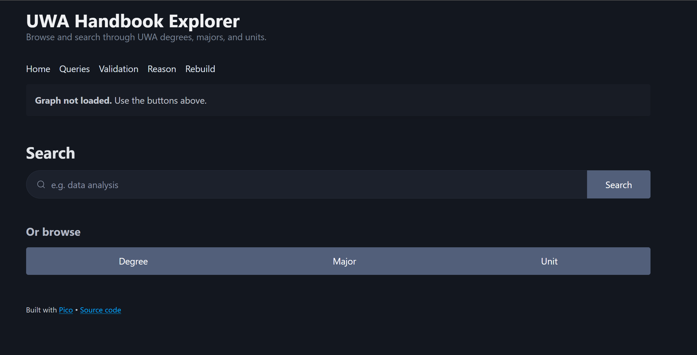
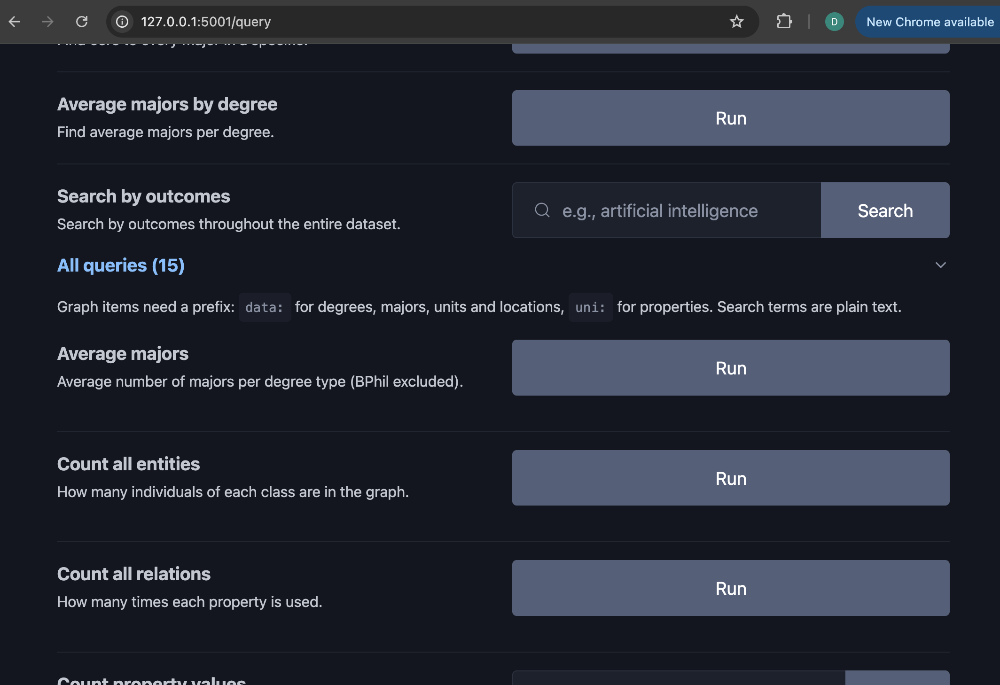

# User Manual
The UWA Handbook is a search engine application. It allows for browsing and querying  of a data set through the use of a knowledge graph. The knowledge graph is built from a scraped JSON file containing handbook information. 

It uses OWL ontology, with reasoning rules, SHACL, SPARQL and a small flask web app to search and run queries.

There are some technical design choices and niche interaction / limitation that exist in the system that wont be covered exactly in this document, but if time permits will be afforded as a technical manual for specific details.

There was some initial idea of a larger scope being added into the system, so some code is left abit open and available or has functions that don't get used fully. e.g. upload and use different datasets or schemas. But most are still hardcoded in compliance to project scope.

Design was taken from [PICO](https://picocss.com/) and framework used for front end design. Some code for the back end was also imported from Homework 2 and parsing attempts fitted to this project.

We used an OOP class based design to create the applicaiton with specfic classes having ownership of allocated responsibilities. There are a fair few files completing different 
tasks. The following outlines the basic folder structure and a basic overview of file funtion.

There are some rouge files from initial design before refactoring into a OOP system. However the files outlined below are the most representative of the final outcome.


| Folder | Description |
|---|---|
| `backend/` | `app.py` - Flask application entry point, `main.py` - Initial pipeline for json -> graph `queries.py` - sparql queries for use in application. |
| `backend/builder/` | This takes  parsed and cleaned JSON data and builds a graph using a selected onology schema.|
| `backend/ontology/` | Seperated schema for ontology. Split between `base.py` (basic entities and facts) `rules.py`(Inferred logic). |
| `backend/shapes/` | SHACL validation checks. |
| `backend/utility/` | This covers shared infrastruce + the parser and caching which kind of ended up there.|
| `backend/data/datasets/` | Holds the source data. We named the handbook data 'raw'. Unsure why.|
| `backend/data/schemas/` | This folder contains the generated output schemas |
| `backend/data/graphs/` | This folder contains generated graphs, including cached ones. |
| `frontend/` | Web interface styling and templates in templates/ |


## 2. Installation and running

### Requirements

- **uv** : <https://docs.astral.sh/uv/>
- **Jave**: Used for reasoner.
- **python** >= 3.14
- **flask** >= 3.1.3
- **owlready2** >= 0.51
- **pyshacl** >= 0.40.1
- **rdflib** >= 7.6.0

**Notes** Changes are reflected in .toml file if failure occurs.

### Install

Run all commands from `application/` folder:

Sync dependencies
```bash
uv sync
```

Run the application
```bash
uv run python src/backend/app.py
```

Then open <http://127.0.0.1:5001> in a browser.

> Amusingly, port 5000 (standard for flask) kept randomly blocking my macOS computer so had to use port 5001

### Inital Usage constraints

The application doesn't directly load the graph -> loading the reasoner on start stopped design workflow. 


To begin querying, you must build the graph and also load/reason over it so the application can access the knowledge graph. You can click on the corresponding buttons to do this. 



**Notes** On the first load it can take a while to reason over the graph. This became increasingly annoying so after it is initally reasoned over, it will save a cached version in data/graphs/ as *.nt files. Loading these caches are a lot faster and will be provided so you don't have to sit through the painful reasoning time. 

This only happens when loaded, rebuilding the graph will result in the cache being emptied.

**Avoid using rebuild as it will delete the cache**

## 2. Schema and Ontology Rules

### Schema
The schema has the following structure:
```bash
Thing
├── Enrollable
│   ├── Degree
│   ├── Major
│   └── Unit
│       └── FloatingUnit  (prerequisite codes not in the dataset)
├── School
├── Location
├── StudyType
│   ├── Bachelor
│   ├── Honours
│   └── Combined
└── ContactMode
```

Relations are added to match the data formatting. These are directly assigned to information seen in the data.

> Data was parsed to view which properties existed, examined for form and given appropriate relations with corrolating characteristics when needed.

### Rules ```rules.py```
- **A degree must have at least one major**: restriction on degrees, this is left open and caught by shacl
- **Combined degrees inherit majors**: property chain for associated majors.
- **Bachelor of Philosophy:** any degree titled "Bachelor of Philosophy (Honours)" is one.
- **Bachelor majors are BPhil majors**: Every major of a Bachelor study type is added to the BPhil list of majors.
- **offersUnit:** property chain. A degree offers every unit in its majors.
- **dependsOnUnit:** property chain. A major depends on all its units prerequisites.
- **Unit levels:** defined classes: FirstYearUnit, SecondYearUnit, ThirdYearUnit and PostgradUnit.
- **Core units:** every unit listed in a major is considered core . A CoreUnit is any unit core to at least one major.
- **Core unit outcomes are major outcomes**: A major recieves the outcomes of its core units.

**Elsewhere**
- **Prerequisites are transitive** (spec): `hasPrerequisite` is a transitive property (`base.py`).
- **A unit can't be its own prerequisite** (spec): SHACL check, reported on the validation page (`shapes.py`).
- **At most 48 level-1 credit points per major** (spec): SHACL check (`shapes.py`).
## 3. Example Queries and how to run them

Querying is built into the application for ease of use. You can find them in ```127.0.0.1:5001/query```
They come as either a button query which runs directly the query, or accepts the string. 

**Notes** Checking of valid entries or UX assistance is abit jank and can often return nothing if a string doesn't correctly match the query, so below will add some additional string entries for each query you can try.


This is a basic aggregation query. It comes as a static method and is imported to the front end using ```inspect.getmembers(Q, inspect.isfunction)```
```python
   @staticmethod
   def count_all_entities():
      """
      Looks at entites as an rdf type for all rdf types
      return the type and the count of it
      
      Filter for strings that start with string type of OWNED schema
      Not rdflib just our made items. Either of namespace uni: or rules:
      """
      query = """
      SELECT ?type (COUNT(*) AS ?count)
      WHERE {
         ?entity rdf:type ?type .
         FILTER(STRSTARTS(STR(?type), STR(uni:)) || STRSTARTS(STR(?type), STR(rules:)))
      }
      GROUP BY ?type
      ORDER BY DESC(?count)
      """
      return query
```

### Queries for string entry queries.

- `search_all`: "python", "Albany", "machine learning"
- `outcome_search`: "data analysis", "ethical", "statistic"
- `get_incoming`: "CITS1401", "MATH1011", "MJD-ANTHR"
- `get_outgoing`: "CITS3005", "MJD-ANTHR", "BP004"
- `get_properties`: "CITS3005", "CITS2200", "BH008"
- `get_parents`: "BH005", "CITS1401", "MJD-ANTHR"
- `list_members`: "Degree", "Major", "BachelorOfPhilosophy"
- `query_by_relation`: "hasMajor", "hasPrerequisite", "locatedIn"
- `count_property_values`: "hasLevel", "hasStudyType", "belongsTo"
- `filter_contains`: "hasTitle" + "computer", "locatedIn" + "Albany", "belongsTo" + "Engineering"
- `foundational_units`: "BH008", "BH011", "BP019"
- `majors_in_location`: "Location_Albany", "Location_UWA_Perth"


### Interpretation
For every query we have embedded surrounding logic to help facilitate UX in terms of interpreting the graph. 

Each query has its own small description on what the query is returning.

When queried we return a table that when applicable returns a subject - relation - object relation to assist the user in reading and understanding the output.

Some directly awkward naming can be hard to understand. 
hasMajorTitle -> has this major and gives the title.

## 4. Updating schema, graph, ontology, queries. 
I'm under the assumption theres not an expectation to add and remove dynamically through the program so this will exlpain the process through the code. Direclty modifying raw data is an available method however, i'm not a fan of removing raw data and we can exclude data from the knowledge graph throught he builder.

All folders and files used for this are in application/src/backend and i'll be referencing with relative pathing from that folder.

### Using a different dataset and changing the schema
One feature of the application allows different datasets and schemas into the system.

You can change these in /utitily/config and updating

```python
DATASET_NAME = "raw"
SCHEMA_NAME = "base"
RULES_NAME = "rules"
```

Dataset name is a directory and expacts 3 files
`degrees.json`, `majors.json` and `units.json`

Schema and rules are the files you wish to use as the schema. If it does not exist it will create it in the correct loaction.

Some limitation of this are that the builder must be updated to represent the new schema and also the parser expects a similar format to the `raw` dataset.

### The schema and ontological rules
The main method of updating the graph include. Adding the requested rule to the ontology or ruleset then allowing the builder
to see the rule and conenct data to the added function.

#### Schema
The ontology folder holds our files for the ontology. We split it into 2 sections for ease of use. Firstly, we 
can look at the `base.py`. This hold the asserted facts in the graph. 

It needs an IRI passed into the function to define the namespace for these objects. It creates a world that the ontology
can be pushed onto and returns the ontology.

> You can add basic information in the following methods:

Add a class object. The class of can be thing or a super class. This gives the relation 
name is a subclass of ClassOf
```python
class Name(<ClassOf>): pass
```

Creating a relation has two main methods. Add a relation to an entity or to a literal. 
Both take a similar structure. 
relation name | (A relationTo B) | Property type (enitity, literal) | characteristic

Example of relation to an entity which has a transistive type property
```python
class hasPrerequisite(Unit >> Unit, ObjectProperty, TransitiveProperty): pass
```
Example of a relation to a string that holds a single property value as a string.
```python
class hasDescription(Enrollable >> str, DataProperty, FunctionalProperty): pass
```
The characteristic help define the expections of the data, with an error occuring if data is passed incorrectly.
#### Ruleset
We define the inferred facts in a seperate file, `rules.py`. Owl accepts different methods of adding inferred facts.
We can give this it's own namespace (preference), load the base schema onto it's world and adds 
the additional rules in a new namespace.

> Example methods for rules to add. 

SWRL is a standard if - then rule set. We can read it as if m and u has defined relation, AND u and o has defined relation
then infer newrelation between m and o.
```python
Imp().set_as_rule(
      'hasCoreUnit(?m, ?u), hasOutcome(?u, ?o)  ->  hasOutcome(?m, ?o)'
      namespaces=ns)
```

A property chain is another method used. It allows us to infer information we don't have
as facts by creating relations based on other relations. If A -> C by means of A -> B -> C, then
A -> C is also a direct relation.
```python
b.hasMajor.property_chain.append(PropertyChain([b.includesDegree, b.hasMajor]))
```

A defined class can be inferred instead of asserted when it's uncertain of the properties. 
Any degree with the title given, must be a bachelor of Philosophy, regardless of code.
```python        
class BachelorOfPhilosophy(b.Degree):
      equivalent_to = [b.Degree & b.hasTitle.value("Bachelor of Philosophy (Honours)")]
```

### Building the graph
At this point we have built a schema as a .owl. but not a knowledge graph. We have to push the data through the
schema and correctly assign data to classes. `builder/build.py` handles this in the system.

A key feature is the ```VOCABULARY``` list. This tells the builder what data is expected from the schema. This must be updated to see the additional classes and relations you add into the ontology. 

You can then define how the data attaches to the schema by assigning the relation to the data.

> Create an entity of type degree using code as the name. Make is a method that handles logic for easier reading.
```python
d = self.make("Degree", code)
```
```python
d.hasTitle = record["title"] # Assign the title of the record to the relation hasTitle.
```

Removing data can also be done with an inverse of operations. This preserves raw data while excluding it from the knowledge graph.

### Queries
This addition was quite interesting. To add a query is extremely simple. In `queries.py` add a static function under the MakeQueries
class, the logic in the queries page will attempt to scan this and provide an actionable query in the applicaiton. 

**Note** Searching using the search bar will attempt to match ANYTHING that contains the requested string. This is intentional and it was planned to add
filtering so that you can filter out desired objects and still find internal
graph structure if requested.


## Contribution to files
# File structure
.
├── app.py                  # Collaborated by both       
├── builder
│   └── build.py.           # Collaborated by both 
├── data
│   ├── datasets
│   │   └── raw
│   │       ├── degrees.json
│   │       ├── majors.json
│   │       └── units.json
│   ├── graphs
│   │   └── raw.owl
│   └── schemas
│       ├── base.owl        
│       ├── rules.owl       
│       └── university_ot.owl
├── main.py                 # Collaborated by both 
├── ontology
│   ├── base.py             # Collaborated by both          
│   ├── rules.py            # Collaborated by both
│   └── university_ot.py    # Justin
├── queries.py              # Collaborated by both
├── shapes
│   ├── shacl_rules.py      # Justin
│   └── shapes.py           # Collaborated by both
└── utility
    ├── caching.py          # Dean
    ├── config.py           # Dean
    ├── datasets.py         # Dean
    ├── parser.py           # Collaborated by both 
    └── utils.py            # Dean

Frontend                    # Justin
